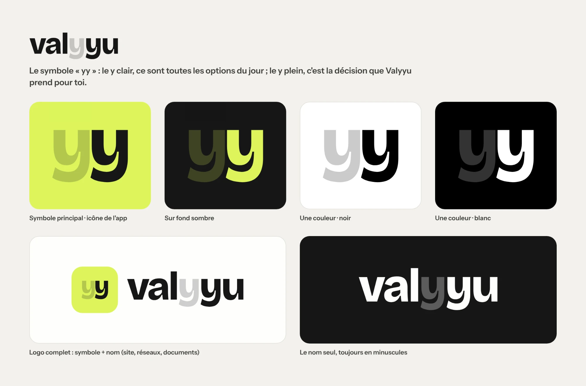
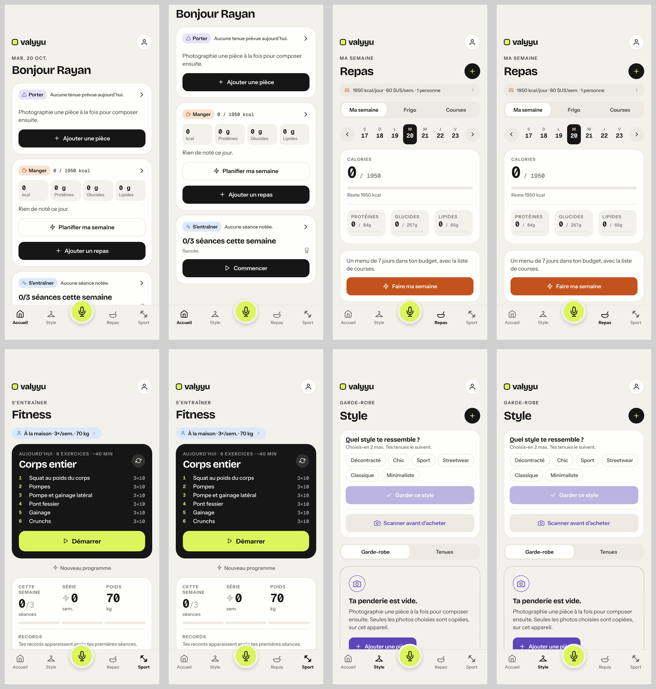
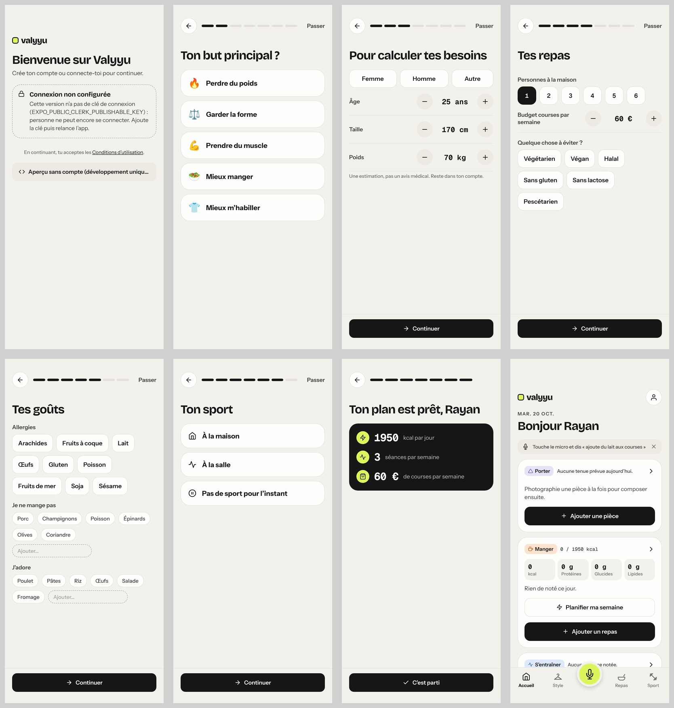
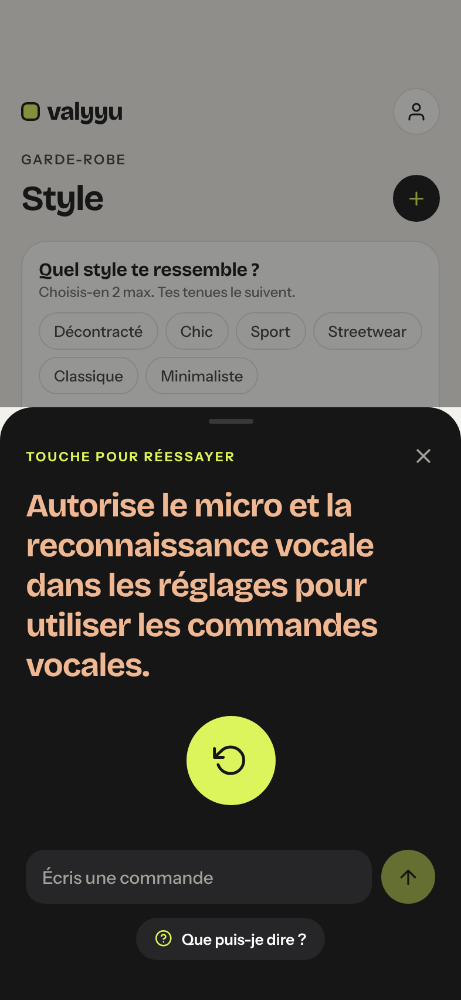

# Prompt pour Claude Design — refonte de l'app Valyyu

> À coller dans Claude Design. Les images ci-dessous sont dans ce même dossier (`docs/design/`) : si Claude Design ne les affiche pas depuis le fichier, joins-les aussi en pièces jointes.

## Images de référence

**Planche logo (identité à respecter)**

**App actuelle : onglets (Accueil, Repas, Sport, Style)**

**App actuelle : connexion et premier lancement**

**App actuelle : feuille du micro (erreur d'autorisation)**

---

## Contexte

Tu es designer produit senior, spécialiste des apps mobiles iOS et Android. Tu refais le design de **Valyyu**, une app grand public qui prend les petites décisions du quotidien à la place de l'utilisateur : quoi manger, quel sport faire, quoi porter.

Promesse : « Ta journée prête en 1 touche. » On montre (photo) ou on dit (voix, texte), et l'app rend un résultat concret, prêt à utiliser. Ce n'est **pas un chatbot**.

Public : tout le monde dès 15 ans, sans profil « sportif » ou « mode » particulier. Règle d'or : **un enfant de 10 ans doit comprendre chaque écran**.

Les images jointes montrent l'app actuelle. Garde son identité, mais **refais la structure et les écrans** : beaucoup de choses ne vont pas (voir « Défauts à corriger »).

## Identité de marque (à respecter)

- Nom : **valyyu**, toujours en minuscules.
- Symbole « yy » : le y clair = les options du jour, le y plein = la décision que Valyyu prend pour toi (voir la planche logo jointe).
- Couleurs de base : papier crème `#F2F1EC`, surface `#FEFEFC`, encre `#161616`, lime `#DDF55C`. Tu peux ajuster les nuances si c'est justifié, mais garde l'esprit crème / encre / lime.
- **Mode clair uniquement.**
- Le **micro** est l'action signature de l'app.

## Normes à respecter (non négociables)

**Plateforme : approche « mixte ».** La structure est **native** : barre d'onglets, barre de navigation avec grand titre, feuilles (bottom sheets), menus et alertes du système, geste retour. Le **contenu est sur mesure** : cartes, micro, écrans des domaines.

- Barre d'onglets : **5 entrées au maximum**, icône + libellé court toujours visibles. **Le contenu ne doit jamais passer sous la barre.**
- Cibles tactiles : **44 × 44 pt minimum**.
- Texte : taille de base 17 pt. L'écran doit **rester utilisable avec le texte agrandi à 200 %** (Dynamic Type) : prévois les retours à la ligne, aucun texte coupé.
- Contraste : texte **≥ 4,5:1** sur son fond ; gros texte, icônes et bordures de champs ≥ 3:1. Le gris pâle du logo est **interdit pour du texte**.
- Une information ne passe **jamais par la couleur seule** : toujours une icône ou un mot en plus.
- Zones protégées : rien d'important sous l'encoche, la Dynamic Island ou la barre de geste.
- **Pas de rangées de pastilles qui défilent horizontalement pour naviguer.** Utilise des onglets, une liste ou un contrôle segmenté de 2 à 4 choix.
- Chaque bouton qui n'a qu'une icône a un **nom lu à voix haute** (indique-le en annotation).
- Langue : français. Prévois **des textes 30 % plus longs** (traductions futures) et un **affichage en miroir pour l'arabe** : raisonne en « début / fin », pas en « gauche / droite ».
- Santé : toute estimation (calories, macros, charges) porte la mention « Estimation, pas un avis médical ». Aucune formulation de diagnostic. Aucune donnée de santé (poids…) affichée en grand sans raison.

## Défauts de l'app actuelle à corriger

1. **Un domaine porte trois noms** (Sport / Fitness / S'entraîner ; Style / Garde-robe / Porter ; Repas / Manger). → **Un seul mot par domaine, partout : Aujourd'hui, Repas, Sport, Style.**
2. Le micro et la barre d'onglets **cachent des boutons et du texte**.
3. Ordre des onglets incohérent avec la promesse « repas, sport, style ».
4. Le même gros en-tête (logo + avatar + sur-titre + titre + bouton rond) est répété sur chaque écran et prend un tiers de la hauteur.
5. **Aucune hiérarchie de boutons** : le bouton principal est tour à tour noir, lime, orange, violet ou mauve pâle.
6. **États vides pleins de zéros** (0 kcal, 0 g, 0/3 séances) : l'accueil a l'air en panne pour un nouvel utilisateur.
7. Premier lancement en 8 étapes, avec des boutons − / + pour l'âge, la taille et le poids.
8. Erreur du micro affichée en énorme titre coloré.
9. Police mono pour les chiffres, qui donne un aspect « terminal ».

## Structure demandée

**Barre d'onglets (native)** : Aujourd'hui · Repas · **Micro** · Sport · Style.
- Le micro est **l'onglet central, mis en avant** (par exemple une pastille lime dans la barre), et ouvre une feuille. Il ne dépasse pas de la barre. Si tu proposes une autre solution, elle doit respecter les normes ci-dessus. Montre 2 variantes au maximum.
- Profil : avatar en haut d'Aujourd'hui seulement.
- **Communauté** (prévue plus tard) : prévois seulement son point d'entrée, une icône dans l'en-tête d'Aujourd'hui. Ne dessine pas les écrans.

**En-têtes** : grand titre natif, actions (par exemple « + ») dans la barre du haut. Logo seulement sur Aujourd'hui et sur l'écran de connexion.

**Boutons** : un seul style de bouton principal (encre), un style secondaire, un style tertiaire (texte). Le **lime est réservé au micro et au moment « décision »**. Les couleurs de domaine (une par domaine, à proposer) servent seulement aux icônes et étiquettes.

## Écrans à dessiner (dans cet ordre de priorité)

1. **Connexion / création de compte** (fournisseur : Clerk)
   - Logo + phrase de promesse.
   - **Se connecter avec Apple**, **Continuer avec Google**, **Continuer avec un e-mail** (code reçu par e-mail). Prévois un emplacement pour le téléphone (SMS), qui sera activé plus tard.
   - Le bouton Apple suit **les règles d'Apple** (bouton officiel noir ou blanc, au moins aussi visible que les autres).
   - Écran de saisie de l'e-mail, puis du code à 6 chiffres (avec « Renvoyer le code »).
   - Liens « Conditions d'utilisation » et « Politique de confidentialité ».
   - États : chargement, erreur (code faux, réseau), compte existant.
2. **Premier lancement** (4 à 5 étapes au maximum)
   - Choix « Parle-moi de toi » (micro) ou « Je préfère répondre aux questions ».
   - Âge (minimum 15 ans, message clair et bienveillant en dessous), taille, poids : champs numériques ou sélecteurs natifs, **pas de − / +**.
   - But, repas (personnes, budget, régimes, allergies), sport (lieu, fréquence).
   - **Consentement aux données de santé** : écran à part, case non pré-cochée, explication simple de ce qui est gardé et pourquoi, possibilité de continuer sans (avec moins de fonctions).
   - Écran final « Ton plan est prêt ».
3. **Aujourd'hui** (« Ma journée »)
   - 3 décisions prêtes (tenue, repas, séance), chacune avec une action « OK » et une action « Changer ».
   - Un état « nouvel utilisateur » sans aucun zéro : 2 ou 3 actions de départ.
   - Un état « journée remplie ».
4. **Feuille du micro**
   - Écoute en cours, compréhension (« J'ai compris : … » + Annuler), résultat.
   - Saisie texte possible.
   - **Pré-autorisation** expliquée avant la demande système du micro, puis une erreur courte avec un bouton « Ouvrir les Réglages ».
5. **Repas** : contrôle segmenté Semaine · Frigo · Courses ; semaine sur 7 jours **fixes** (pas de défilement) ; réglages (budget, personnes) dans une feuille.
6. **Sport** : séance du jour (garde l'esprit de la carte sombre actuelle, la plus réussie), démarrer une séance, saisir une série vite, remplacer un exercice, progression.
7. **Style** : contrôle segmenté Garde-robe · Tenues ; grille de pièces ; tenue du jour selon la météo ; remplacer une seule pièce.
8. **Profil et réglages** : liste native (compte, abonnement, notifications, données et confidentialité, **supprimer mon compte**, langue = lien vers les réglages du téléphone).
9. **Abonnement (paywall)** : prix, renouvellement automatique, essai gratuit, **« Restaurer mes achats »**, liens vers les conditions. Conforme aux règles de l'App Store.

Pour chaque écran : état normal, **état vide**, état de chargement, état d'erreur.

## Ce que j'attends de toi

1. **Un design system** avant les écrans : couleurs (avec le contraste de chaque paire texte/fond), échelle typographique compatible Dynamic Type, espacements (multiples de 4), rayons, ombres, icônes. **Nomme chaque valeur comme un token** (par exemple `color.ink`, `space.4`, `radius.card`) : le développeur les recopiera tels quels dans le code.
2. **Les composants de base** et leurs états (normal, pressé, désactivé, focus) : bouton (principal, secondaire, tertiaire), bouton-icône, carte, champ de saisie, ligne de liste, contrôle segmenté, feuille, étiquette de domaine, onglet micro.
3. **Les écrans ci-dessus**, au format iPhone 6,1″ (393 × 852 pt). Ajoute **une version de l'écran Aujourd'hui avec le texte agrandi**.
4. Pour chaque écran, **une ou deux lignes d'annotation** : ce qui est natif, ce qui est sur mesure, les noms lus à voix haute des boutons-icônes.
5. Si une de mes demandes contredit une norme d'Apple, de Google ou d'accessibilité, **dis-le et propose une alternative** au lieu de la suivre.

Commence par le design system et l'écran de connexion. Montre-les-moi avant de continuer.
